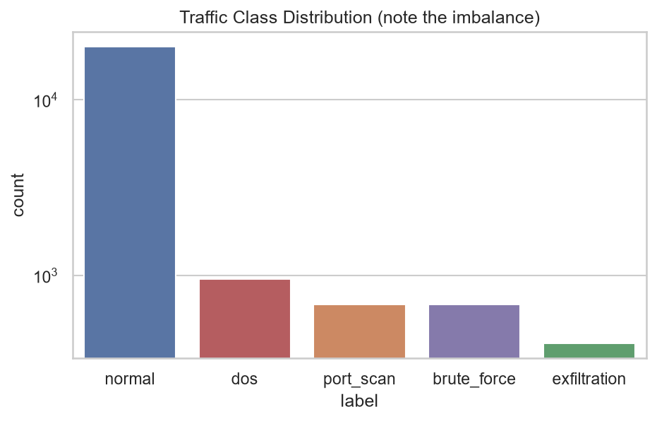
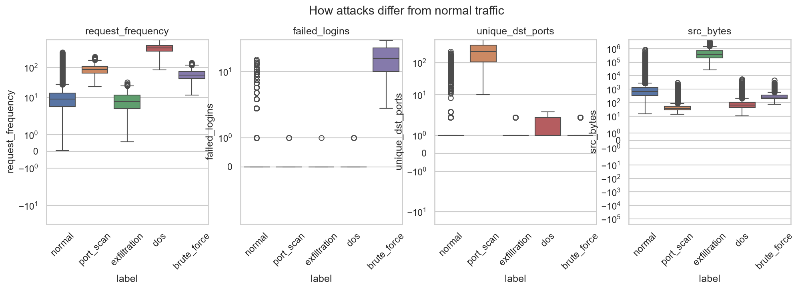
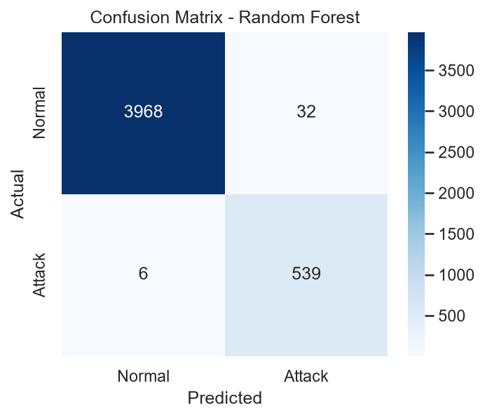
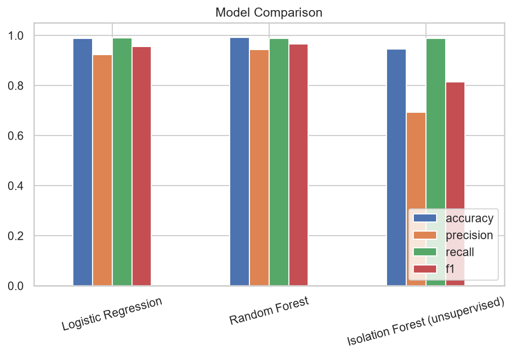
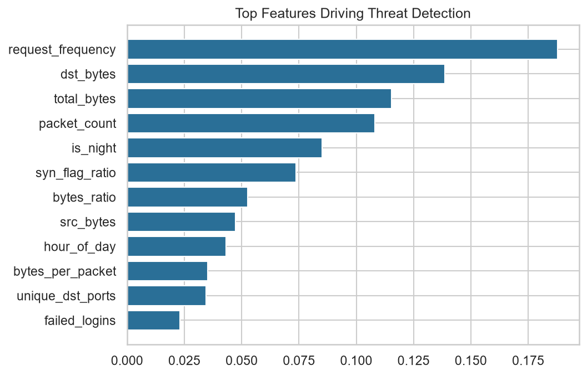
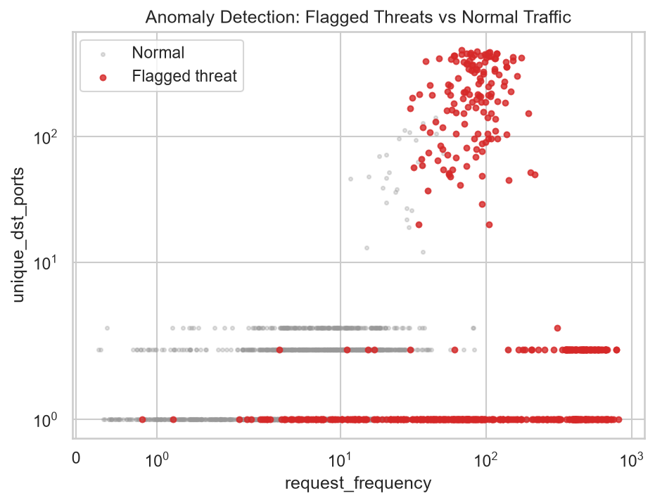
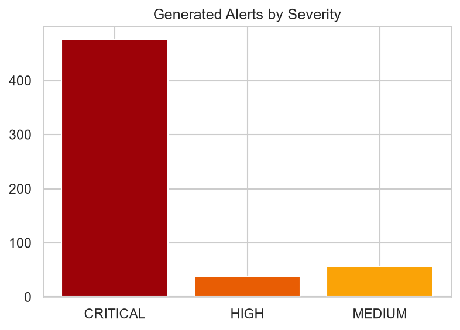

# 🛡️ AI-Powered Cybersecurity Threat Detection System

A machine-learning pipeline that detects network attacks (**DoS, brute force, port scan, data exfiltration**) from traffic data, ranks them by severity, and produces SOC-style alerts. Built on **simulated network traffic** (and compatible with the public **NSL-KDD** dataset) because real corporate logs are not available to students.

## 📌 Problem Statement
Rule-based security tools only catch attacks they already know. Attackers change tactics, and analysts drown in alerts. This project trains ML models that learn what *normal* traffic looks like and flag deviations, with a probability score and a plain-English reason for each alert.

## 🏢 Industry Relevance
Same ideas power intrusion detection (IDS/IPS), SIEM alerting, fraud monitoring and UEBA at banks, IT services firms and cloud/security vendors. This project mirrors that flow: **ingest → preprocess → detect → alert → visualise**.

## 🧰 Tech Stack
Python 3.10+ · Pandas · NumPy · Scikit-learn (Random Forest, Logistic Regression, Isolation Forest) · Matplotlib · Seaborn · Flask (optional real-time API)

## 🏗️ Architecture
```
Traffic data (simulated / NSL-KDD)
        │
        ▼
 Cleaning ─► Feature engineering ─► Preprocessing pipeline (impute, scale, encode)
        │
        ├──► Random Forest / Logistic Regression  (supervised: attack vs normal)
        └──► Isolation Forest                      (unsupervised: trained on normal only)
        │
        ▼
 Threat detection logic ─► Alerts (severity + reason) ─► Charts & CSV reports ─► Flask API
```

## 📊 Dataset
- **Simulated (default):** ~24k flows, 5 behaviours, ~12% attacks, with missing values, **stealthy "low-and-slow" attacks** and **legit-but-weird normal traffic** so classes overlap like real life. Generated by `src/simulate.py`.
- **Optional real data:** NSL-KDD (`python main.py run --source nslkdd --path data/raw/KDDTrain+.txt`).

## ⚙️ Installation
```bash
git clone https://github.com/<your-username>/AI-Cybersecurity-Threat-Detection.git
cd AI-Cybersecurity-Threat-Detection
python -m venv venv
venv\Scripts\activate          # Windows
# source venv/bin/activate     # Mac/Linux
pip install -r requirements.txt
```

## ▶️ How to Run
```bash
python main.py run                 # full pipeline: data → train → evaluate → alerts → charts
python -m src.predict_api          # optional: real-time API on http://127.0.0.1:5000
python -m pytest                   # run tests
```
Test the API:
```bash
curl -X POST http://127.0.0.1:5000/predict -H "Content-Type: application/json" -d "{\"duration\":2,\"protocol\":\"tcp\",\"service\":\"ssh\",\"src_bytes\":300,\"dst_bytes\":200,\"packet_count\":30,\"request_frequency\":70,\"failed_logins\":25,\"unique_dst_ports\":1,\"syn_flag_ratio\":0.3,\"hour_of_day\":3}"
```

## 📈 Results (simulated test set, 20% hold-out)
| Model | Accuracy | Precision | Recall | F1 |
|---|---|---|---|---|
| Logistic Regression | 0.989 | 0.923 | 0.991 | 0.956 |
| Random Forest | 0.992 | 0.944 | 0.989 | 0.966 |
| Isolation Forest (no labels) | 0.946 | 0.692 | 0.987 | 0.814 |

> Numbers will vary slightly with data/seed. In security, **recall** (missed attacks) and **precision** (false alarms) matter more than accuracy because attacks are rare.

## 🖼️ Screenshots
| | |
|---|---|
|  |  |
|  |  |
|  |  |
|  | |

## 🎓 Learning Outcomes
Handling imbalanced data · preventing label leakage · sklearn Pipelines · supervised vs unsupervised detection · precision/recall trade-offs · alert prioritisation · serving a model via API.

## ⚠️ Limitations & Future Work
Simulated data is simpler than real traffic; next steps: CICIDS2017/UNSW-NB15, streaming ingestion (Kafka), SHAP explainability, a Streamlit dashboard, Docker, SIEM integration.

## 📜 License
MIT
### Results explained
- **Random Forest** was my best model: recall 0.989 means it caught about 99% of attacks, and precision 0.944 means about 94% of its alerts were real attacks.
- **Logistic Regression** was close behind, which shows the simulated attacks are fairly separable.
- **Isolation Forest** never saw attack labels, yet still caught 98.7% of attacks. Its precision was lower (0.692), so it raises more false alarms.
- **Why not just accuracy?** About 88% of the traffic is normal, so accuracy alone can look high even for a weak detector. Recall and precision show how well attacks are actually found.